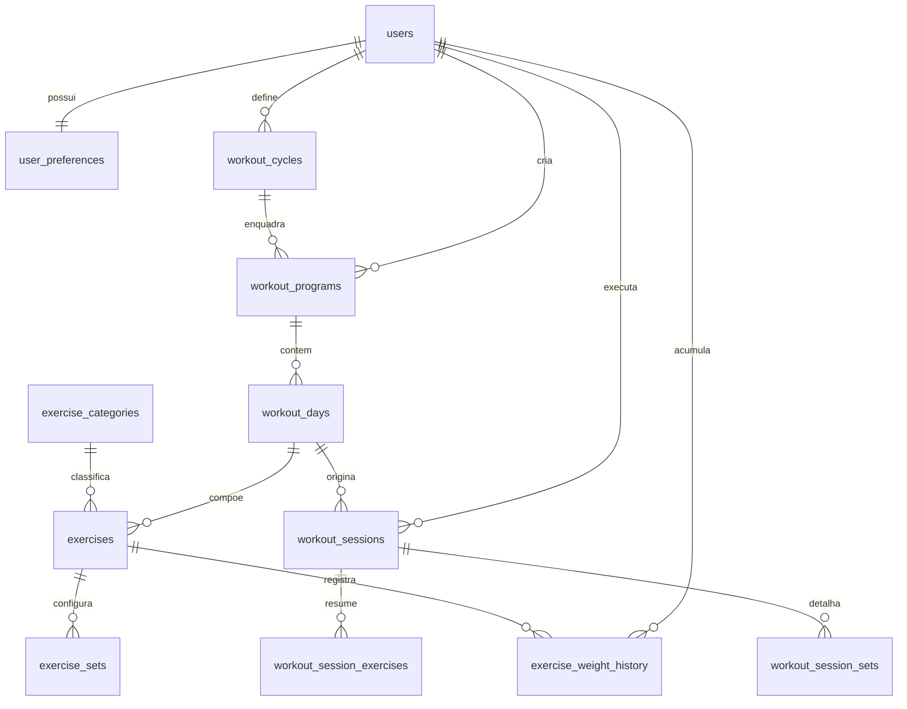

# Documentação Técnica da Arquitetura de Banco de Dados — AppFit

## 1. Visão Geral e Contexto do Projeto

O **AppFit** é um Progressive Web App (PWA) de alta performance voltado para acompanhamento de rotinas de treino, controle de execução de séries, cronometragem automática de descanso e rastreamento de evolução de cargas.

Para garantir persistência segura, integridade referencial, concorrência e conformidade **ACID** (Atomicidade, Consistência, Isolamento e Durabilidade), foi implementado o **PostgreSQL 16.6** como Sistema Gerenciador de Banco de Dados Relacional (SGBD).

### Especificações do Ambiente
- **SGBD**: PostgreSQL 16.6 (x64)
- **Database**: `appfit_db`
- **Encoding / Collation**: UTF-8 / C
- **Localização dos Binários**: `C:\Users\Luan Azevedo\pgsql\bin`
- **Localização dos Dados**: `C:\Users\Luan Azevedo\pgsql\data`
- **Porta**: `5432` (TCP/IP localhost)

---

## 2. Decisões de Modelagem e Níveis de Normalização

A modelagem foi concebida seguindo rigorosamente as formas normais clássicas até a **3ª Forma Normal (3NF)** e **Forma Normal de Boyce-Codd (BCNF)**, combinada com uma estratégia deliberada de *snapshots* históricos para garantir imutabilidade de execuções passadas.

```
                    ┌────────────────────────────────────────────────────────┐
                    │               PRINCÍPIOS DE NORMALIZAÇÃO               │
                    └────────────────────────────────────────────────────────┘
                                               │
             ┌─────────────────────────────────┼─────────────────────────────────┐
             ▼                                 ▼                                 ▼
   ┌───────────────────┐             ┌───────────────────┐             ┌───────────────────┐
   │ 1ª FORMA NORMAL   │             │ 2ª FORMA NORMAL   │             │ 3ª FORMA NORMAL   │
   │ (Atomicidade)     │             │ (Dep. Total)      │             │ (Sem Transitiva)  │
   ├───────────────────┤             ├───────────────────┤             ├───────────────────┤
   │ Séries e cargas   │             │ Atributos de cada │             │ Categorias e      │
   │ não ficam em      │             │ entidade dependem │             │ preferências      │
   │ colunas ou arrays │             │ exclusivamente da │             │ separadas em suas │
   │ concatenados.     │             │ PK daquela tabela.│             │ próprias tabelas. │
   └───────────────────┘             └───────────────────┘             └───────────────────┘
```

### 2.1. Primeira Forma Normal (1NF)
- **Eliminação de Grupos Repetidos**: Na modelagem anterior baseada em JSON do frontend, as séries (`sets`) e histórico de cargas (`weightHistory`) eram coleções aninhadas. No PostgreSQL, cada série é uma linha distinta na tabela `exercise_sets`, com atributos atômicos (`set_number`, `target_reps`, `current_weight`).
- **Atomicidade**: Todas as colunas contêm valores indivisíveis. Nenhuma informação de múltiplos pesos ou repetições é concatenada em strings arbitrárias.

### 2.2. Segunda Forma Normal (2NF)
- **Dependência Funcional Completa**: Todas as tabelas possuem chaves primárias bem definidas. Todos os atributos não-chave dependem funcionalmente da chave primária inteira e não de subconjuntos de chaves compostas.

### 2.3. Terceira Forma Normal (3NF) & BCNF
- **Eliminação de Dependências Transitivas**: Atributos que dependiam indiretamente de outra coluna foram isolados:
  - Grupos musculares foram normalizados na tabela `exercise_categories`.
  - Preferências do usuário foram separadas na tabela `user_preferences`.
  - Ciclos de treino e programas foram divididos em `workout_cycles`, `workout_programs` e `workout_days`.

### 2.4. Desnormalização Consciente de Snapshots de Auditoria
Em aplicativos de treino, se um usuário alterar o nome de um exercício de *"Supino Reto"* para *"Supino Inclinado"* ou deletar uma rotina antiga, **os treinos passados já realizados não podem ser corrompidos ou descaracterizados**.
Por essa razão de negócio:
- A tabela `workout_sessions` mantém um snapshot `workout_title` e `day_name`.
- A tabela `workout_session_exercises` armazena o nome e carga executada naquele dia histórico, mantendo integridade mesmo se o exercício base for alterado no futuro.

---

## 3. Diagrama Entidade-Relacionamento (ERD)



---

## 4. Dicionário de Dados e Estrutura das Tabelas

### 4.1. `users` (Usuários e Autenticação)
Armazena a identidade do usuário, credenciais e método de autenticação.

| Coluna | Tipo | Restrições | Descrição |
| :--- | :--- | :--- | :--- |
| `id` | `VARCHAR(64)` | **PK** | Identificador único do usuário |
| `name` | `VARCHAR(150)` | `NOT NULL` | Nome completo ou apelido |
| `email` | `VARCHAR(255)` | `NOT NULL, UNIQUE, CHECK(regex)` | E-mail corporativo ou pessoal |
| `password_hash`| `VARCHAR(255)` | `NULLABLE` | Hash da senha (quando local) |
| `avatar_url` | `TEXT` | `NULLABLE` | Link ou base64 da foto de perfil |
| `auth_provider`| `VARCHAR(50)` | `DEFAULT 'email', CHECK` | Provedor: `'email'`, `'google'`, `'apple'` |
| `is_email_verified` | `BOOLEAN` | `DEFAULT false` | Flag de validação de e-mail |
| `created_at` | `TIMESTAMPTZ` | `DEFAULT CURRENT_TIMESTAMP` | Data/hora de cadastro |
| `updated_at` | `TIMESTAMPTZ` | `DEFAULT CURRENT_TIMESTAMP` | Data/hora de última atualização |

### 4.2. `user_preferences` (Preferências e Interface)
Configurações individuais de experiência do usuário.

| Coluna | Tipo | Restrições | Descrição |
| :--- | :--- | :--- | :--- |
| `user_id` | `VARCHAR(64)` | **PK, FK -> users(id) ON DELETE CASCADE** | Vínculo 1:1 com o usuário |
| `default_rest_seconds` | `INTEGER` | `DEFAULT 60, CHECK (10..600)` | Tempo de descanso padrão (segundos) |
| `sound_enabled` | `BOOLEAN` | `DEFAULT true` | Alertas sonoros habilitados |
| `vibration_enabled` | `BOOLEAN` | `DEFAULT true` | Vibração háptica no celular |
| `screen_wake_lock_enabled` | `BOOLEAN` | `DEFAULT true` | Manter tela ativa durante o treino |
| `theme` | `VARCHAR(30)` | `DEFAULT 'dark'` | Tema visual (dark/light) |

### 4.3. `exercise_categories` (Tabela de Domínio / Grupos Musculares)
Catálogo normalizado de categorias musculares.

| Coluna | Tipo | Restrições | Descrição |
| :--- | :--- | :--- | :--- |
| `id` | `SERIAL` | **PK** | Código sequencial numérico |
| `code` | `VARCHAR(50)` | `NOT NULL, UNIQUE` | Identificador curto (ex: `peito`, `costas`) |
| `name` | `VARCHAR(100)` | `NOT NULL, UNIQUE` | Rótulo formatado para exibição |
| `color_hex` | `VARCHAR(7)` | `DEFAULT '#06b6d4'` | Cor hexadecimal temática da badge |

### 4.4. `workout_cycles` (Ciclos e Periodização)
Controla o período de vigência de uma periodização de treinos.

| Coluna | Tipo | Restrições | Descrição |
| :--- | :--- | :--- | :--- |
| `id` | `VARCHAR(64)` | **PK** | Identificador do ciclo |
| `user_id` | `VARCHAR(64)` | **FK -> users(id) ON DELETE CASCADE** | Dono do ciclo |
| `name` | `VARCHAR(100)` | `DEFAULT 'Ciclo Regular'` | Nome da periodização (ex: 'Fase de Força') |
| `start_date` | `DATE` | `NOT NULL` | Data de início |
| `end_date` | `DATE` | `NOT NULL, CHECK (end_date >= start_date)` | Data de término prevista |
| `duration_weeks` | `INTEGER` | `DEFAULT 4, CHECK (> 0)` | Duração em semanas |
| `duration_months` | `INTEGER` | `DEFAULT 1, CHECK (> 0)` | Duração em meses |
| `is_active` | `BOOLEAN` | `DEFAULT true` | Indica se é o ciclo em andamento |

### 4.5. `workout_programs` (Programas de Treino)
Agrupador das rotinas de treino ativas do usuário.

| Coluna | Tipo | Restrições | Descrição |
| :--- | :--- | :--- | :--- |
| `id` | `VARCHAR(64)` | **PK** | Identificador do programa |
| `user_id` | `VARCHAR(64)` | **FK -> users(id) ON DELETE CASCADE** | Usuário associado |
| `cycle_id` | `VARCHAR(64)` | **FK -> workout_cycles(id) ON DELETE SET NULL** | Ciclo ao qual pertence |
| `title` | `VARCHAR(150)` | `NOT NULL` | Título (ex: 'Programa Hipertrofia A/B/C') |
| `division_type` | `VARCHAR(30)` | `CHECK ('weekly', 'alphabetical')` | Distribuição (semanal ou rotinas A/B/C) |
| `is_active` | `BOOLEAN` | `DEFAULT true` | Se é o programa ativo na tela principal |

### 4.6. `workout_days` (Dias e Rotinas do Programa)
Rotinas individuais (ex: Segunda-feira ou Treino A).

| Coluna | Tipo | Restrições | Descrição |
| :--- | :--- | :--- | :--- |
| `id` | `VARCHAR(64)` | **PK** | Identificador da rotina |
| `program_id` | `VARCHAR(64)` | **FK -> workout_programs(id) ON DELETE CASCADE** | Programa pai |
| `day_code` | `VARCHAR(20)` | `NOT NULL` | Código identificador (ex: `'A'`, `'SEG'`) |
| `day_name` | `VARCHAR(100)` | `NOT NULL` | Nome curto (ex: `'Treino A'`) |
| `title` | `VARCHAR(150)` | `NOT NULL` | Título completo (ex: `'Treino A - Peito'`) |
| `short_label` | `VARCHAR(50)` | `NOT NULL` | Rótulo para botões e abas |
| `category_badge` | `VARCHAR(100)` | `NOT NULL` | Badge de cabeçalho |
| `order_index` | `INTEGER` | `DEFAULT 1, CHECK (> 0)` | Ordem de exibição na lista |
| `is_rest_day` | `BOOLEAN` | `DEFAULT false` | Se é dia de descanso / regeneração |
| *Restrição Composta* | `UNIQUE(program_id, day_code)` | Evita duplicidade de rotina no mesmo programa |

### 4.7. `exercises` (Exercícios da Ficha)
Exercícios cadastrados dentro de uma rotina.

| Coluna | Tipo | Restrições | Descrição |
| :--- | :--- | :--- | :--- |
| `id` | `VARCHAR(64)` | **PK** | Identificador do exercício |
| `workout_day_id` | `VARCHAR(64)` | **FK -> workout_days(id) ON DELETE CASCADE** | Rotina à qual pertence |
| `category_id` | `INTEGER` | **FK -> exercise_categories(id) ON DELETE SET NULL** | Chave estrangeira de categoria |
| `category` | `VARCHAR(100)` | `NOT NULL` | Nome descritivo da categoria |
| `name` | `VARCHAR(200)` | `NOT NULL` | Nome do exercício (ex: 'Supino Reto') |
| `order_index` | `INTEGER` | `DEFAULT 1, CHECK (> 0)` | Posição ordinal no dia |
| `series_count` | `INTEGER` | `DEFAULT 3, CHECK (> 0)` | Quantidade de séries planejadas |
| `reps_description` | `VARCHAR(100)` | `NOT NULL` | Faixa de repetições (ex: `'3x 8 a 10'`) |
| `rest_description` | `VARCHAR(100)` | `DEFAULT '60s'` | Descanso alvo entre séries |
| `orientation` | `TEXT` | `NULLABLE` | Dicas de execução e postura |
| `is_optional` | `BOOLEAN` | `DEFAULT false` | Flag se o exercício é facultativo |
| `last_weight` | `NUMERIC(6, 2)` | `DEFAULT 0.00, CHECK (>= 0)` | Cache rápido da última carga máxima |
| *Restrição Composta* | `UNIQUE(workout_day_id, order_index)` | Garante unicidade de ordenação |

### 4.8. `exercise_sets` (Séries Planejadas do Exercício)
Configuração série a série de cada exercício.

| Coluna | Tipo | Restrições | Descrição |
| :--- | :--- | :--- | :--- |
| `id` | `VARCHAR(64)` | **PK** | Identificador da série |
| `exercise_id` | `VARCHAR(64)` | **FK -> exercises(id) ON DELETE CASCADE** | Exercício pai |
| `set_number` | `INTEGER` | `NOT NULL, CHECK (> 0)` | Número ordinal da série (1, 2, 3...) |
| `target_reps` | `VARCHAR(50)` | `NOT NULL` | Meta de repetições |
| `current_weight` | `NUMERIC(6, 2)` | `DEFAULT 0.00, CHECK (>= 0)` | Carga salva pelo usuário (preservada) |
| `is_completed` | `BOOLEAN` | `DEFAULT false` | Estado transitório de conclusão |
| `completed_at` | `TIMESTAMPTZ` | `NULLABLE` | Carimbo de conclusão |
| *Restrição Composta* | `UNIQUE(exercise_id, set_number)` | Não permite números de série duplicados |

### 4.9. `workout_sessions` (Sessões Executadas / Histórico)
Registro de sessões de treino iniciadas pelo botão *"Iniciar Treino"*.

| Coluna | Tipo | Restrições | Descrição |
| :--- | :--- | :--- | :--- |
| `id` | `VARCHAR(64)` | **PK** | Identificador da sessão |
| `user_id` | `VARCHAR(64)` | **FK -> users(id) ON DELETE CASCADE** | Usuário que executou |
| `workout_day_id` | `VARCHAR(64)` | **FK -> workout_days(id) ON DELETE SET NULL** | Rotina de origem |
| `workout_title` | `VARCHAR(150)` | `NOT NULL` | Snapshot do título do treino |
| `day_name` | `VARCHAR(100)` | `NOT NULL` | Snapshot do nome do dia |
| `started_at` | `TIMESTAMPTZ` | `NOT NULL` | Data/hora de início |
| `ended_at` | `TIMESTAMPTZ` | `NULLABLE` | Data/hora de encerramento |
| `duration_seconds` | `INTEGER` | `DEFAULT 0, CHECK (>= 0)` | Tempo total decorrido |
| `status` | `VARCHAR(30)` | `CHECK ('in_progress', 'completed', 'canceled')` | Estado da sessão |
| `total_sets` | `INTEGER` | `DEFAULT 0, CHECK (>= 0)` | Total de séries do treino |
| `completed_sets` | `INTEGER` | `DEFAULT 0, CHECK (>= 0)` | Séries efetivamente realizadas |
| `user_comment` | `TEXT` | `NULLABLE` | Comentário/feedback final do usuário |

### 4.10. `workout_session_exercises` (Resumo dos Exercícios na Sessão)
Registra o desempenho por exercício em uma sessão concluída.

| Coluna | Tipo | Restrições | Descrição |
| :--- | :--- | :--- | :--- |
| `id` | `VARCHAR(64)` | **PK** | Identificador do resumo |
| `session_id` | `VARCHAR(64)` | **FK -> workout_sessions(id) ON DELETE CASCADE** | Sessão correspondente |
| `exercise_id` | `VARCHAR(64)` | **FK -> exercises(id) ON DELETE SET NULL** | Exercício |
| `exercise_name` | `VARCHAR(200)` | `NOT NULL` | Nome histórico do exercício |
| `completed_sets` | `INTEGER` | `DEFAULT 0, CHECK (>= 0)` | Séries concluídas |
| `max_weight` | `NUMERIC(6, 2)` | `DEFAULT 0.00, CHECK (>= 0)` | Carga máxima atingida no dia |
| `order_index` | `INTEGER` | `DEFAULT 1` | Ordem de realização |

### 4.11. `workout_session_sets` (Log Auditável Série a Série)
Auditoria granular de cada série efetuada.

| Coluna | Tipo | Restrições | Descrição |
| :--- | :--- | :--- | :--- |
| `id` | `VARCHAR(64)` | **PK** | Identificador do log da série |
| `session_id` | `VARCHAR(64)` | **FK -> workout_sessions(id) ON DELETE CASCADE** | Sessão executada |
| `exercise_id` | `VARCHAR(64)` | **FK -> exercises(id) ON DELETE SET NULL** | Exercício |
| `exercise_name` | `VARCHAR(200)` | `NOT NULL` | Nome do exercício |
| `set_number` | `INTEGER` | `NOT NULL, CHECK (> 0)` | Número da série |
| `reps_completed` | `VARCHAR(50)` | `NULLABLE` | Repetições concluídas |
| `weight_used` | `NUMERIC(6, 2)` | `DEFAULT 0.00, CHECK (>= 0)` | Carga utilizada nesta série |
| `completed_at` | `TIMESTAMPTZ` | `DEFAULT CURRENT_TIMESTAMP` | Data/hora da marcação |

### 4.12. `exercise_weight_history` (Progressão de Carga por Exercício)
Alimenta os gráficos de evolução e cálculo de deltas (`+2kg 🚀`).

| Coluna | Tipo | Restrições | Descrição |
| :--- | :--- | :--- | :--- |
| `id` | `VARCHAR(64)` | **PK** | Identificador do registro |
| `user_id` | `VARCHAR(64)` | **FK -> users(id) ON DELETE CASCADE** | Usuário |
| `exercise_id` | `VARCHAR(64)` | **FK -> exercises(id) ON DELETE CASCADE** | Exercício monitorado |
| `session_id` | `VARCHAR(64)` | **FK -> workout_sessions(id) ON DELETE SET NULL** | Sessão onde ocorreu a carga |
| `recorded_at` | `TIMESTAMPTZ` | `DEFAULT CURRENT_TIMESTAMP` | Data/hora do registro |
| `weight` | `NUMERIC(6, 2)` | `NOT NULL, CHECK (>= 0)` | Carga levantada (kg) |
| `reps` | `VARCHAR(50)` | `NULLABLE` | Repetições atingidas |
| `notes` | `VARCHAR(255)` | `NULLABLE` | Observações (ex: "Novo recorde") |

---

## 5. Integridade Referencial e Regras de Negócio

### 5.1. Políticas de Remoção (`ON DELETE`)
1. **`CASCADE`**: Aplicado para relações fortes de pertencimento:
   - Apagar um `user` remove suas preferências, ciclos, programas e histórico.
   - Apagar um `workout_program` remove automaticamente seus `workout_days`, `exercises` e `exercise_sets`.
   - Apagar uma `workout_session` remove seus registros detalhados de séries e resumos.
2. **`SET NULL`**: Aplicado para preservar histórico imutável:
   - Se um exercício ou dia for deletado da ficha atual, as sessões de treino realizadas no passado não são deletadas. A coluna de referência passa a `NULL`, enquanto as colunas snapshot (`workout_title`, `exercise_name`) preservam intactos os relatórios passados e estatísticas de presença do usuário.

### 5.2. Tipos Numéricos Seguros (`NUMERIC(6, 2)`)
- Cargas na musculação utilizam incrementos de frações de quilo (ex: `12.5 kg`, `2.5 kg`, `0.5 kg`).
- Tipos de ponto flutuante binário como `FLOAT` ou `REAL` sofrem de imprecisão de arredondamento IEEE 754 (ex: `12.500000001`).
- O uso de `NUMERIC(6, 2)` garante precisão decimal exata, com capacidade para pesos de até `9.999,99 kg`.

### 5.3. Fusos Horários (`TIMESTAMPTZ`)
- Todas as datas e horas de início e fim de treino utilizam `TIMESTAMP WITH TIME ZONE` (`TIMESTAMPTZ`), garantindo consistência cronológica mesmo em mudanças de horário de verão ou quando o usuário viaja para outros estados/países.

---

## 6. Otimização de Performance e Índices

O banco possui 12 índices criados estrategicamente para atender aos padrões de acesso do aplicativo:

| Nome do Índice | Tabela | Colunas | Objetivo |
| :--- | :--- | :--- | :--- |
| `idx_users_email` | `users` | `email` | Busca ultrarrápida durante o login |
| `idx_cycles_user_active` | `workout_cycles` | `user_id, is_active` | Resgata ciclo corrente sem scan sequencial |
| `idx_programs_user_active` | `workout_programs` | `user_id, is_active` | Identifica a ficha ativa do usuário |
| `idx_days_program_order` | `workout_days` | `program_id, order_index` | Ordena as abas (Treino A, B, C...) |
| `idx_exercises_day_order` | `exercises` | `workout_day_id, order_index` | Renderiza a lista de exercícios ordenada |
| `idx_sets_exercise_num` | `exercise_sets` | `exercise_id, set_number` | Lista séries 1, 2, 3 com custo mínimo |
| `idx_sessions_user_date` | `workout_sessions` | `user_id, started_at DESC` | Alimenta o calendário histórico de treinos |
| `idx_weight_history_ex_date` | `exercise_weight_history` | `exercise_id, recorded_at DESC` | Traça curvas de progressão de carga |

---

## 7. Visões Analíticas (SQL Views)

### 7.1. `v_active_workout_summary`
Consolida o programa em vigor, agrupando o total de exercícios planejados e total de séries configuradas por dia da semana ou rotina:
```sql
SELECT day_code, day_name, day_title, total_exercises, total_sets 
FROM v_active_workout_summary;
```

### 7.2. `v_exercise_progression`
Utiliza funções analíticas de janela (`LAG() OVER (...)`) para calcular automaticamente a carga anterior e a variação (`weight_delta`) entre os treinos:
```sql
SELECT 
    exercise_name,
    recorded_at::date,
    weight,
    previous_weight,
    weight_delta,
    notes
FROM v_exercise_progression;
```

---

## 8. Guia de Administração e Scripts Utilitários

Um script de automação em PowerShell foi incluído em `database/manage_db.ps1`:

```powershell
# Verificar status do PostgreSQL
.\database\manage_db.ps1 -Action status

# Iniciar o servidor de banco de dados
.\database\manage_db.ps1 -Action start

# Parar o servidor com encerramento seguro
.\database\manage_db.ps1 -Action stop

# Abrir o shell interativo psql
.\database\manage_db.ps1 -Action psql

# Recriar as tabelas e reinserir os dados iniciais
.\database\manage_db.ps1 -Action reset
```
